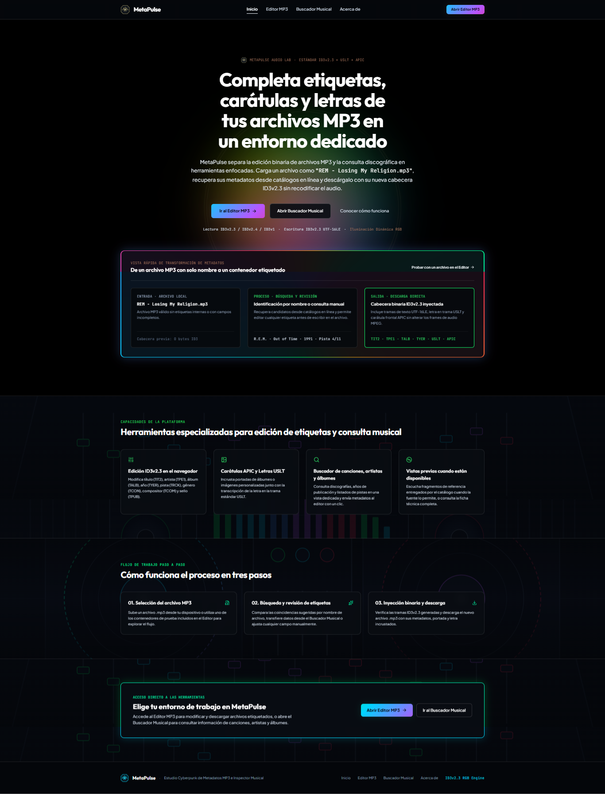

# MetaPulse — Estudio Cyberpunk de Metadatos MP3 e Inspector Musical

[](https://metapulse.falconit.xyz/)

🔗 **Aplicación en vivo:** **[Ver en Vivo — https://metapulse.falconit.xyz/](https://metapulse.falconit.xyz/)**

**MetaPulse** es una aplicación web organizada en vistas dedicadas con estética de estudio musical e iluminación dinámica **RGB multicolor** para analizar, autocompletar, editar e inyectar etiquetas binarias **ID3v2.3**, letras de canciones (**USLT**) y carátulas (**APIC 600×600 px**) directamente en archivos `.mp3`, acompañada de un buscador discográfico de canciones, artistas y álbumes.

---

## Vista General de la Plataforma

[](https://metapulse.falconit.xyz/)

### Desglose Visual de Cómo Funciona la Interfaz (según la captura superior)

1. **Cabecera de Navegación Superior (3 Zonas)**:
   - **Izquierda**: Identidad de marca con el emblema vectorial reactivo `MetaPulseLogo`.
   - **Centro**: Enlaces directos entre las vistas dedicadas (`Inicio`, `Editor MP3`, `Buscador Musical`, `Acerca de`).
   - **Derecha**: Acceso rápido mediante el botón con gradiente RGB animado **«Abrir Editor MP3»**.

2. **Sección Hero Centrada con Burbuja Arcoíris RGB y Ondas Pulsantes**:
   - Sobre un fondo negro puro (`#000000`), una burbuja gradiente multicolor y ondas concéntricas suaves irradian detrás del bloque central de títulos y acciones.
   - Permite saltar directamente al **Editor MP3** (`/editor`), abrir el **Buscador Musical** (`/search`) o consultar la documentación técnica (`/about`).

3. **Cuadro de Transformación de Metadatos con Borde de Líneas RGB Animado**:
   - Enmarcado por un borde perimetral continuo de líneas RGB que cambian constantemente de color, muestra de un vistazo cómo evoluciona un archivo local:
     - **Entrada · Archivo Local**: Un contenedor como `"REM - Losing My Religion.mp3"` sin etiquetas internas (`0 bytes ID3`).
     - **Proceso · Búsqueda y Revisión**: Identificación automática por nombre de archivo o consulta manual en catálogo (`R.E.M. · Out of Time · 1991 · Pista 4/11`).
     - **Salida · Descarga Directa**: Cabecera binaria `ID3v2.3` inyectada (`TIT2 · TPE1 · TALB · TYER · USLT · APIC`) con texto en `UTF-16LE` sin recodificar ni alterar los frames de audio MPEG.

4. **Capacidades de la Plataforma (Fondo de Consola de Estudio con Opacidad Oscura)**:
   - Presenta las 4 capacidades nucleares sobre una consola de mezcla profesional con faders, analizador de espectro y monitores de estudio bajo una capa oscura de alto contraste:
     - **Edición ID3v2.3 en el navegador** (`TIT2`, `TPE1`, `TALB`, `TYER`, `TRCK`, `TCON`, `TCOM`, `TPUB`).
     - **Carátulas APIC y Letras USLT** incrustadas directamente en el binario.
     - **Buscador de canciones, artistas y álbumes** conectado con el editor.
     - **Vistas previas de audio** cuando el catálogo público las proporciona.

5. **Flujo de Trabajo Paso a Paso (Fondo de Cabina de Producción y Vinilos con Opacidad Oscura)**:
   - **01. Selección del archivo MP3**: Carga desde el dispositivo o selección de contenedores de prueba incluidos en el Editor.
   - **02. Búsqueda y revisión de etiquetas**: Comparación de coincidencias sugeridas, envío desde el Buscador Musical o edición manual.
   - **03. Inyección binaria y descarga**: Verificación en tiempo real de las tramas `ID3v2.3` generadas y descarga inmediata del nuevo archivo `.mp3`.

---

## Arquitectura de Navegación y Páginas (`react-router-dom`)

| Ruta | Vista | Propósito |
|---|---|---|
| `/` | **Inicio (`HomePage`)** | Presentación centrada con ondas RGB, cuadro demostrativo de transformación con borde RGB animado y resumen del flujo en 3 pasos sobre fondos de estudio musical. |
| `/editor` | **Editor MP3 (`EditorPage`)** | Entorno dedicado para cargar archivos `.mp3`, autocompletar etiquetas, editar letra `USLT` y portada `APIC`, verificar tramas binarias post-escritura y descargar el archivo etiquetado. |
| `/search` | **Buscador Musical (`SearchPage`)** | Entorno dedicado para consultar canciones, artistas y álbumes, escuchar fragmentos de referencia cuando están disponibles y transferir metadatos al Editor MP3 con un clic. |
| `/about` | **Acerca de (`AboutPage`)** | Documentación técnica detallada sobre el motor binario `ID3v2.3`, fuentes públicas de datos y preguntas frecuentes. |
| `*` | **404 (`NotFoundPage`)** | Pantalla de recuperación de ruta con accesos directos a Inicio, Editor MP3 y Buscador Musical. |

---

## Características Técnicas Principales

### 1. Motor Binario ID3v2.3 (`/editor`)
- **Lectura Multi-Versión**: Interpreta cabeceras existentes `ID3v2.3`, `ID3v2.4` e `ID3v1` al cargar cualquier archivo `.mp3` local.
- **Escritura Binaria Estándar ID3v2.3**:
  - Codificación `UTF-16LE` con BOM (`0xFF 0xFE`) para compatibilidad con caracteres internacionales y acentos en reproductores de escritorio, móviles y sistemas de audio.
  - Tramas soportadas: `TIT2` (Título), `TPE1` (Artista), `TALB` (Álbum), `TYER` (Año), `TRCK` (Número de pista), `TCON` (Género), `TCOM` (Compositor), `TPUB` (Sello discográfico), `USLT` (Letra completa no sincronizada), `COMM` (Comentarios) y `APIC` (Carátula frontal `0x03`).
- **Verificación Post-Escritura (`verifyWrittenMp3Blob`)**: Al generar el archivo de salida, MetaPulse vuelve a leer la cabecera binaria del `Blob` resultante para confirmar que el título, artista, álbum, letra (`USLT`) y carátula (`APIC`) quedaron grabados correctamente antes de iniciar la descarga.

### 2. Buscador Musical e Inspector Discográfico (`/search`)
- **Modos de Consulta**: Búsqueda filtrada por **Canciones**, **Artistas y Discografía** y **Álbumes** con cancelación automática de peticiones en vuelo (`AbortController`).
- **Transferencia Directa al Editor**: El botón **«Usar en Editor»** envía los metadatos normalizados (incluyendo carátula en alta resolución y búsqueda automática de letra) directamente a la ruta `/editor`.

### 3. Iluminación Dinámica RGB y Ambientación de Estudio Musical
- **Ciclo RGB Automático**: Las variables CSS globales (`--neon-primary`, `--neon-glow`, `--neon-border`) transicionan de forma fluida y simultánea a través de los 4 colores característicos de MetaPulse (**Verde Neón `#00FF66`**, **Azul Cian `#00D4FF`**, **Morado Cyber `#B855FF`** y **Rojo Carmesí `#FF2A54`**).
- **Fondos Vectoriales de Estudio**: Las secciones secundarias y vistas de herramientas utilizan ilustraciones vectoriales de consolas de mezcla (`public/studio-console-bg.svg`) y cabinas de vinilos (`public/studio-synth-vinyl-bg.svg`) con una capa de opacidad oscura para garantizar contraste tipográfico óptimo.

---

## Estructura del Proyecto

```text
├── index.html                        # Metadatos SEO, OpenGraph, JSON-LD y tipografías
├── vercel.json                       # Configuración de compilación Vite y rewrites SPA
├── .npmrc                            # Resolución limpia de dependencias en despliegues
├── public/
│   ├── metapulse-logo.svg            # Logo vectorial oficial de MetaPulse
│   ├── metapulse-og.svg              # Imagen OpenGraph (1200×630)
│   ├── studio-console-bg.svg         # Fondo vectorial de consola de estudio musical
│   ├── studio-synth-vinyl-bg.svg     # Fondo vectorial de cabina de producción y tornamesas
│   └── assets/aistudio/              # Capturas y documentación de referencia del proyecto
└── src/
    ├── App.tsx                       # Configuración de BrowserRouter y rutas con carga diferida (lazy)
    ├── index.css                     # Ciclo de iluminación RGB, bordes animados y fondos de estudio
    ├── main.tsx                      # Punto de entrada React
    ├── types/
    │   └── music.ts                  # Modelos TypeScript de metadatos y catálogo
    ├── utils/
    │   └── id3.ts                    # Lector/escritor/verificador binario ID3v2.3 (UTF-16LE, USLT, APIC)
    ├── services/
    │   └── musicCatalog.ts           # Consultas a APIs de catálogo y letras con AbortSignal
    ├── components/
    │   ├── layout/
    │   │   └── AppLayout.tsx         # Cabecera de 3 zonas, scroll-to-top y pie de página
    │   ├── MetaPulseLogo.tsx         # Emblema SVG reactivo al ciclo RGB
    │   ├── CoverArtVisual.tsx        # Renderizador resiliente de portadas con respaldo SVG
    │   ├── Mp3TaggerStudio.tsx       # Motor de interfaz del Editor MP3
    │   └── CatalogExplorer.tsx       # Motor de interfaz del Buscador Musical
    └── pages/
        ├── HomePage.tsx              # Ruta / (Hero con ondas RGB + Cuadro RGB + Secciones de estudio)
        ├── EditorPage.tsx            # Ruta /editor
        ├── SearchPage.tsx            # Ruta /search
        ├── AboutPage.tsx             # Ruta /about
        └── NotFoundPage.tsx          # Ruta * (404)
```
